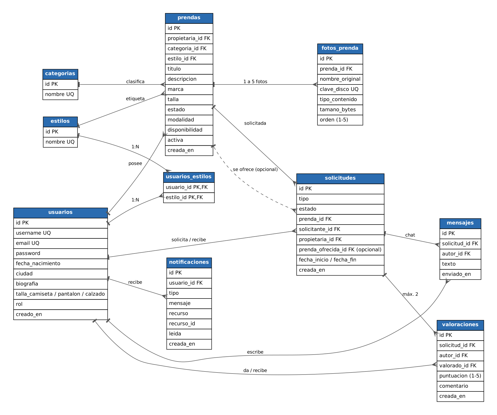

# SwapCloset · Backend

Backend de **SwapCloset**, una plataforma donde un grupo de jóvenes se **intercambian y se prestan ropa** sin depender de WhatsApp: publican prendas con fotos, las piden en intercambio o préstamo, hablan por un chat interno, se valoran y reciben avisos cuando un préstamo está a punto de vencer.

Proyecto integrado de 2º DAM (Acceso a Datos) · **Pablo Martínez Villadiego**

## Tecnologías

Java 21 · Spring Boot 3.5 · Spring Web · Spring Data JPA · PostgreSQL 16 (Docker Compose) · Spring Security + JWT (jjwt) · Lombok · MapStruct · Bean Validation (con un validador propio) · springdoc (Swagger UI) · JUnit 5 + MockMvc.

## Cómo arrancarlo

Necesitas **Java 21** y **Docker Desktop** encendido.

```powershell
docker compose up -d        # arranca PostgreSQL (publicado en el puerto 5433)
.\mvnw.cmd spring-boot:run  # arranca la API en http://localhost:8080
```

- **Swagger UI:** http://localhost:8080/swagger-ui.html
- **Conexión a la base de datos** (DBeaver, IntelliJ...): host `localhost`, puerto **5433**, base `swapcloset`, usuario `swapcloset`, contraseña `swapcloset`.
- **Tests:** `.\mvnw.cmd test` (con la base de datos arrancada). Cada test se revierte al terminar y no modifica los datos.
- Variables de entorno que se pueden cambiar: `DB_URL`, `DB_USER`, `DB_PASSWORD`, `JWT_SECRET` y `STORAGE_DIR` (valores por defecto en `application.yml`; ejemplo en `.env.example`).
- **Perfil `dev`:** `.\mvnw.cmd spring-boot:run "-Dspring-boot.run.profiles=dev"` ejecuta la tarea programada cada minuto en lugar de a las 08:00, para poder verla funcionar.

> **Los datos de prueba se recrean en cada arranque.** `schema.sql` borra y vuelve a crear las tablas y `data.sql` las rellena, así que cualquier dato creado a mano se pierde al reiniciar. Es intencionado: la demo siempre parte del mismo estado. (En una versión de producción se usaría una herramienta de migraciones como Flyway.)

## Usuarios de prueba

Todos tienen la contraseña **`Password1!`**.

| Usuario | Rol | Para probar |
|---|---|---|
| `mariana` | ADMIN | Informe de actividad |
| `laura_mod`, `david_mod` | MODERADOR | Informe; retirar prendas ajenas |
| `lucia_s` | USUARIO | Prenda 1 con 5 fotos; recibe solicitudes |
| `carlos_r` | USUARIO | Intercambio aceptado (solicitud 3) |
| `sofia_m` | USUARIO | Ya tiene **3 préstamos activos** (límite RN-05) |
| `pablo_v` | USUARIO | Tiene los 5 estilos; recibe la solicitud 1 |
| `ana_g`, `javi_t`, `marta_l`, `diego_p`, `nuria_c` | USUARIO | Resto de casos (pendientes, valoraciones, retrasos) |

Datos pensados para las pruebas: la prenda 20 es un borrador sin fotos; la 19 está retirada; las solicitudes 1 a 11 cubren todos los estados; la solicitud 1 está pendiente desde hace 10 días (la tarea programada la caduca) y la 5 es un préstamo vencido (la tarea la marca como retrasada).

## Modelo de datos



10 tablas. El diagrama con todos los atributos está también en `docs/diagrama.dbml` (se pega en dbdiagram.io) y el análisis de requisitos en `docs/analisis.md`.

## Arquitectura

```
controller  →  service  →  repository  →  PostgreSQL
   │              │
   │              └─ mapper (MapStruct) · storage (ficheros) · scheduler (tareas)
   └─ dto request / response (nunca se exponen las entidades)
```

- Inyección por constructor (`@RequiredArgsConstructor`), sin `@Autowired` en campos.
- Las entidades no usan `@Data`: su `equals/hashCode/toString` recorrerían las relaciones y provocarían cargas perezosas o bucles. Llevan `@Getter/@Setter` y `@ToString(exclude = ...)`.
- Todas las relaciones son `LAZY`; las consultas que necesitan relaciones las traen con `JOIN FETCH` o `@EntityGraph` para evitar el problema N+1.
- Todos los enums se guardan como texto (`@Enumerated(EnumType.STRING)`).
- Un único `@RestControllerAdvice` convierte todas las excepciones en `ProblemDetail`.

## Seguridad

- **Registro** y **login** devuelven un **token JWT** válido 60 minutos. Se envía en la cabecera `Authorization: Bearer <token>`.
- Contraseñas guardadas con **BCrypt**; el rol nunca lo elige quien se registra (siempre `USUARIO`).
- **401** si falta el token o es inválido/caducado. **403** si la persona está identificada pero no tiene permiso.
- Roles `ADMIN`, `MODERADOR` y `USUARIO`. `@PreAuthorize` protege el informe (solo ADMIN y MODERADOR) y el acceso a solicitudes, chat y valoraciones (solo las dos personas de la solicitud, RN-08).
- El catálogo (prendas, categorías y fotos de prendas publicadas) y Swagger se pueden ver sin cuenta.
- La identidad sale siempre del token, nunca de la petición.

## Endpoints

| Nº | Método y ruta | Quién | Qué hace |
|---|---|---|---|
| — | `POST /api/v1/auth/registro` | público | Crear cuenta y recibir el token |
| — | `POST /api/v1/auth/login` | público | Iniciar sesión con usuario o email |
| 1 | `GET /api/v1/prendas` | público | Buscar con filtros (categoría, talla, estado, estilo, ciudad, modalidad) y paginación |
| 2 | `GET /api/v1/prendas/{id}` | público | Detalle con fotos y reputación de la propietaria |
| 3 | `POST /api/v1/prendas` | autenticada | Publicar una prenda (queda en BORRADOR) |
| 4 | `PUT /api/v1/prendas/{id}` | propietaria | Modificar una prenda propia |
| 5 | `DELETE /api/v1/prendas/{id}` | propietaria o moderación | Retirar (baja lógica) |
| 6 | `GET /api/v1/categorias` | público | Categorías con su número de prendas |
| 7 | `GET /api/v1/usuarios/{id}` | autenticada | Perfil público |
| 8 | `PUT /api/v1/usuarios/me` | autenticada | Editar mi perfil, tallas y estilos |
| 9 | `GET /api/v1/usuarios/afines` | autenticada | Personas con estilos en común |
| 10 | `POST /api/v1/solicitudes` | autenticada | Pedir una prenda en intercambio o préstamo |
| 11 | `GET /api/v1/solicitudes` | autenticada | Mis solicitudes enviadas o recibidas (`vista`, `estado`) |
| — | `GET /api/v1/solicitudes/{id}` | participantes | Detalle de una solicitud |
| 12 | `PATCH /api/v1/solicitudes/{id}/estado` | participantes | Aceptar, rechazar, cancelar o finalizar |
| 13 | `POST /api/v1/solicitudes/{id}/mensajes` | participantes | Enviar un mensaje |
| 14 | `GET /api/v1/solicitudes/{id}/mensajes` | participantes | Leer la conversación (paginada) |
| 15 | `POST /api/v1/solicitudes/{id}/valoraciones` | participantes | Valorar a la otra persona |
| 16 | `GET /api/v1/informes/actividad` | ADMIN, MODERADOR | Actividad por mes y categoría, y ranking |
| 17 | `POST /api/v1/prendas/{id}/fotos` | propietaria | Subir una foto (multipart, campo `foto`) |
| 18 | `GET /api/v1/fotos/{id}` | público* | Descargar una foto |
| 19 | `GET /api/v1/notificaciones` | autenticada | Mis notificaciones (`leida=true\|false`, paginadas) |
| 20 | `PATCH /api/v1/notificaciones/{id}/leida` | autenticada | Marcar una notificación como leída |

\* Las fotos de borradores y de prendas retiradas solo las ven su propietaria y la moderación.

La colección de Postman con todos estos endpoints, y los tests incluidos, está en `docs/SwapCloset.postman_collection.json` (importar junto a `docs/SwapCloset.postman_environment.json`). El login guarda el token automáticamente.

## Reglas de negocio

| Regla | Cómo se cumple |
|---|---|
| **RN-01** Mayor de 16 años; email y usuario únicos | Validador propio `@EdadMinima` (registro); comprobación previa y `UNIQUE` en la base de datos (409) |
| **RN-02** De 1 a 5 estilos; rangos de tallas | Bean Validation y servicio (422 si un estilo no existe); `CHECK` en `usuarios` |
| **RN-03** Sin fotos = borrador; máximo 5 fotos | La primera foto publica la prenda; límite en el servicio y `CHECK orden BETWEEN 1 AND 5` |
| **RN-04** No solicitar lo propio ni dos pendientes de la misma prenda | Servicio (422/409); `CHECK solicitante <> propietaria`; índice único parcial |
| **RN-05** Préstamo de 30 días como máximo y 3 activos | Servicio; `CHECK` de fechas |
| **RN-06** Transiciones de estado | Máquina de estados en `SolicitudServiceImpl` (422 si no está permitida) |
| **RN-07** Efectos de aceptar y finalizar | Transacción: reserva las prendas, rechaza las demás pendientes (`@Modifying`) y, al finalizar un intercambio, las prendas cambian de dueña |
| **RN-08** Chat solo entre los dos participantes | `@PreAuthorize` + comprobación en el servicio (403) |
| **RN-09** Una valoración por participante, solo en solicitudes finalizadas | Servicio (422/409); `UNIQUE (solicitud_id, autor_id)` |
| **RN-10** Baja lógica de prendas | Campo `activa`; al retirar se cancelan sus solicitudes pendientes |

### Códigos de error

Todos los errores salen como `ProblemDetail` (JSON con `status`, `title`, `detail`, `instance` y `timestamp`):

| Código | Cuándo |
|---|---|
| 400 | Datos mal formados o que no pasan la validación (incluye la lista `errores` por campo) |
| 401 | Falta el token, es inválido o ha caducado; credenciales incorrectas |
| 403 | Sin permiso (rol insuficiente o recurso de otra persona) |
| 404 | El recurso no existe (o no es visible para esa persona) |
| 409 | Duplicado: email, usuario, solicitud pendiente o valoración repetidos |
| 413 | Foto de más de 5 MB |
| 415 | Fichero que no es JPEG, PNG o WebP (se comprueba también el contenido real) |
| 422 | Regla de negocio incumplida |

## Consultas JPA

| # | Formato | Repositorio | Método | Lo usa |
|---|---|---|---|---|
| 1 | Q1 derivada | UsuarioRepository | `existsByEmailIgnoreCase`, `existsByUsernameIgnoreCase` | Registro (RN-01, 409) |
| 2 | Q1 derivada | UsuarioRepository | `findByUsernameIgnoreCase`, `findByEmailIgnoreCase` | Login (UserDetailsService) |
| 3 | Q1 derivada | SolicitudRepository | `countBySolicitanteIdAndTipoAndEstadoIn` | Límite de 3 préstamos (RN-05) |
| 4 | Q1 derivada | SolicitudRepository | `existsBySolicitanteIdAndPrendaIdAndEstado` | No duplicar pendientes (RN-04) |
| 5 | Q1 derivada | PrendaRepository | `findTop5By...ContainingIgnoreCase...OrderBy`, `findByCreadaEnBetween...` | Endpoint 1 / sugerencias |
| 6 | Q1 derivada | MensajeRepository / ValoracionRepository / NotificacionRepository / FotoPrendaRepository | `findBySolicitudIdOrderByEnviadoEnAsc`, `existsBySolicitudIdAndAutorId`, `existsByUsuarioIdAndTipoAndRecursoId`, `findFirstByPrendaIdOrderByOrdenDesc` | Endpoints 13-15, tarea programada, fotos |
| 7 | Q2 JPQL JOIN + COUNT + GROUP BY | UsuarioRepository | `buscarAfines` | Endpoint 9 |
| 8 | Q2 JPQL AVG | ValoracionRepository | `reputacionMedia` | Endpoints 2 y 7 |
| 9 | Q2 JPQL JOIN + COUNT + GROUP BY (left join con ON) | CategoriaRepository | `contarPrendasPorCategoria` | Endpoint 6 |
| 10 | Q2 JPQL JOIN | SolicitudRepository | `findRecibidasPorDuenaDePrenda` | Endpoint 11 |
| 11 | Q3 nativa (DATE_TRUNC, FILTER) | SolicitudRepository | `actividadPorCategoriaYMes` | Endpoint 16 |
| 12 | Q3 nativa (ranking) | SolicitudRepository | `rankingUsuariasActivas` | Endpoint 16 |
| 13 | Q4 @Modifying | SolicitudRepository | `cambiarEstadoPendientesDePrenda` | Aceptar solicitud (RN-07) |
| 14 | Q4 @Modifying | SolicitudRepository | `caducarPendientesAnterioresA` | Tarea de las 08:00 |
| 15 | Q4 @Modifying | SolicitudRepository | `marcarPrestamosRetrasados` | Tarea de las 08:00 |
| 16 | Q5 interfaz + Q6 Pageable | PrendaRepository | `listarTarjetasDePropietaria` (`PrendaTarjetaView`) | Endpoint 7 |
| 17 | Q5 record `SELECT new` | SolicitudRepository | `resumenPorCategoria` (`ActividadCategoriaDto`) | Endpoint 16 |
| 18 | Q6 paginación | MensajeRepository / NotificacionRepository / SolicitudRepository | `findBySolicitudId`, `findByUsuarioIdAndLeida`, `findBySolicitanteId...` | Endpoints 11, 14 y notificaciones |
| 19 | Q7 Specification | PrendaRepository + `PrendaSpecs` | `findAll(Specification, Pageable)` | Endpoint 1 |
| 20 | Q8 @EntityGraph | PrendaRepository | `findDetalleById` | Endpoint 2 |
| 21 | Q8 @EntityGraph | UsuarioRepository | `findConEstilosById` | Endpoint 7 / perfil |
| 22 | Q2 JPQL AVG + GROUP BY + Q5 interfaz | ValoracionRepository | `reputaciones` (`ReputacionView`) | Endpoints 7 y 9 (reputación de varias personas en una consulta) |
| 23 | Q2 JPQL (`count > 0`) | SolicitudRepository | `participa` | `@PreAuthorize` de solicitudes, chat y valoraciones (RN-08) |
| 24 | Q8 @EntityGraph | SolicitudRepository / FotoPrendaRepository | `findConRelacionesById`, `findConPrendaById` | Endpoints 10-15 y descarga de fotos |

Probadas en `RepositoriosTest` y a través de los tests de los controladores.

## Tareas programadas

Cada día a las **08:00** (configurable en `app.scheduling.cron-solicitudes`):

1. Avisa a las dos personas de los préstamos que **vencen mañana**.
2. Marca como **RETRASADA** los préstamos vencidos y avisa.
3. **Caduca** las solicitudes pendientes de más de 7 días.

Es **idempotente**: se puede ejecutar varias veces sin duplicar avisos ni cambios. Detalle en `docs/tareas.md`.

## Decisiones de diseño

- **`propietaria_id` también en `solicitudes`.** Al finalizar un intercambio las prendas cambian de dueña. Si la propietaria se dedujera siempre de la prenda, el chat y las valoraciones de solicitudes antiguas apuntarían a otra persona. Es una desnormalización consciente.
- **Cada prenda tiene su propio `estilo_id`**, para poder filtrar el catálogo por estilo sin depender del perfil de su dueña.
- **Tres conceptos distintos en la prenda:** `estado` (conservación), `disponibilidad` (BORRADOR, DISPONIBLE, RESERVADA, PRESTADA) y `activa` (baja lógica).
- **La reputación no se guarda: se calcula** con `AVG` sobre las valoraciones, así nunca queda desincronizada. En los listados se calcula de varias personas en una sola consulta.
- **Reglas también en la base de datos.** Los `CHECK` y los índices únicos parciales (una sola solicitud pendiente por persona y prenda, sin avisos duplicados) protegen los datos aunque falle el servicio.
- **Las fotos se guardan en disco** con nombre aleatorio (UUID) y en la base de datos solo sus metadatos. Se valida el contenido real del fichero, no solo lo que declara el cliente, y la clave se comprueba contra una expresión estricta para impedir salir de la carpeta.
- **Un 404 en lugar de un 403** cuando alguien pide una foto privada: no se revela que existe.

## Estructura del proyecto

```
src/main/java/es/safareyes/swapcloset/
  config/      Seguridad, Swagger, tareas programadas
  controller/  Endpoints REST
  dto/         request, response, projection, validation
  entity/      Entidades JPA y enums
  exception/   Excepciones y GlobalExceptionHandler
  mapper/      MapStruct
  repository/  Spring Data JPA (+ Specifications)
  scheduler/   Tarea programada
  security/    JWT, filtro y manejo de 401/403
  service/     Lógica de negocio y almacenamiento
src/main/resources/  application.yml, schema.sql, data.sql
docs/                análisis, diagramas, consultas, tareas y colección de Postman
```
