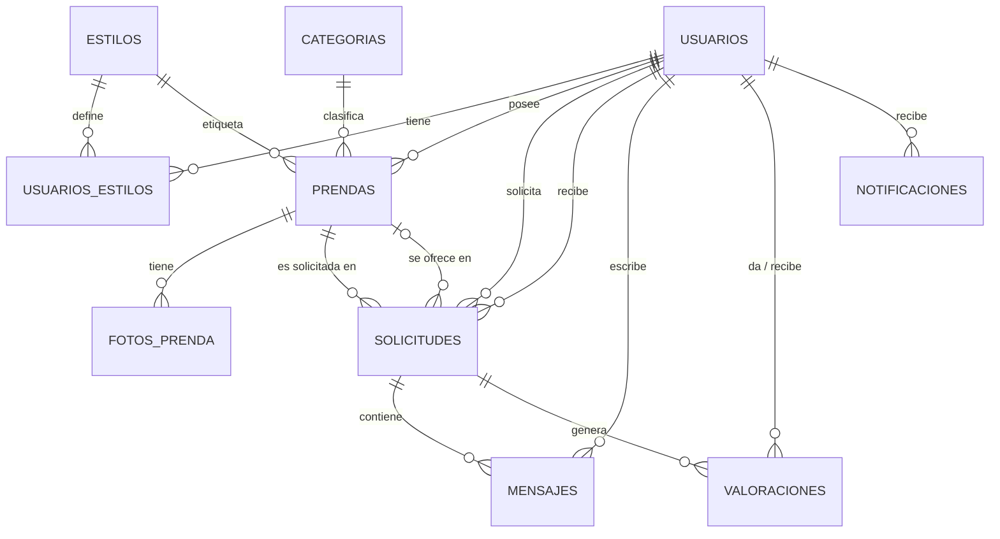

# Análisis de SwapCloset

Proyecto integrado backend · 2º DAM · Pablo Martínez Villadiego

## 1. Resumen del problema

Mariana y su grupo de amigas se prestan e intercambian ropa por WhatsApp y han perdido el control de quién tiene qué. Necesitan una plataforma donde publicar prendas con fotos, pedirlas en **intercambio** o **préstamo**, hablar con la otra persona sin dar su teléfono, valorarse mutuamente y conocer gente con su mismo estilo.

## 2. Sustantivos, verbos y condiciones detectados

| Sustantivos (entidades / atributos) | Verbos (operaciones) | Condiciones (reglas) |
|---|---|---|
| perfil, usuario, ciudad, biografía, tallas, estilos, prenda, marca, categoría, talla, estado, foto, solicitud, intercambio, préstamo, fechas, chat, mensaje, valoración, reputación, notificación | registrarse, publicar, buscar, solicitar, aceptar, rechazar, cancelar, caducar, finalizar, chatear, valorar, sugerir, avisar, retirar | mayor de 16, 1 a 5 estilos, 1 a 5 fotos, préstamo máximo 1 mes, máximo 3 préstamos a la vez, caduca a los 7 días, aviso el día antes y al retrasarse |

## 3. Entidades y atributos

| Entidad (tabla) | Atributos | Restricciones destacadas |
|---|---|---|
| **Usuario** (`usuarios`) | id, username, email, password, fechaNacimiento, ciudad, biografía, tallaCamiseta, tallaPantalon, tallaCalzado, rol, creadoEn, actualizadoEn | username y email únicos; camiseta XS-XXL, pantalón 34-50, calzado 35-46; rol ADMIN/MODERADOR/USUARIO |
| **Estilo** (`estilos`) | id, nombre | nombre único |
| **Categoria** (`categorias`) | id, nombre | nombre único |
| **Prenda** (`prendas`) | id, propietaria, categoría, estilo, título, descripción, marca (opcional), talla, estado, modalidad, disponibilidad, activa, creadaEn, actualizadaEn | estado, modalidad y disponibilidad con CHECK |
| **FotoPrenda** (`fotos_prenda`) | id, prenda, nombreOriginal, claveDisco, tipoContenido, tamañoBytes, orden, creadaEn | clave en disco única; orden 1-5 único por prenda; solo jpeg/png/webp y máx. 5 MB |
| **Solicitud** (`solicitudes`) | id, tipo, estado, prenda, solicitante, propietaria, prendaOfrecida (opcional), fechaInicio, fechaFin, creadaEn, actualizadaEn | coherencia tipo/fechas/prenda ofrecida; préstamo de 30 días como máximo |
| **Mensaje** (`mensajes`) | id, solicitud, autor, texto, enviadoEn | texto entre 1 y 1.000 caracteres |
| **Valoracion** (`valoraciones`) | id, solicitud, autor, valorado, puntuación, comentario (opcional), creadaEn | puntuación 1-5; una por autor y solicitud |
| **Notificacion** (`notificaciones`) | id, usuario, tipo, mensaje, recurso, recursoId, leída, creadaEn | índice único que evita duplicar avisos de vencimiento y retraso |

### Enums (se guardan con `@Enumerated(EnumType.STRING)`)

| Enum | Valores |
|---|---|
| `Rol` | ADMIN, MODERADOR, USUARIO |
| `TallaCamiseta` | XS, S, M, L, XL, XXL |
| `EstadoPrenda` (conservación) | NUEVA_CON_ETIQUETA, COMO_NUEVA, BUEN_ESTADO, USADA |
| `Modalidad` | INTERCAMBIO, PRESTAMO, AMBAS |
| `Disponibilidad` | BORRADOR, DISPONIBLE, RESERVADA, PRESTADA |
| `TipoSolicitud` | INTERCAMBIO, PRESTAMO |
| `EstadoSolicitud` | PENDIENTE, ACEPTADA, RECHAZADA, CANCELADA, CADUCADA, RETRASADA, FINALIZADA |
| `TipoNotificacion` | SOLICITUD_RECIBIDA, SOLICITUD_ACEPTADA, SOLICITUD_RECHAZADA, NUEVO_MENSAJE, PRESTAMO_VENCE_MANANA, PRESTAMO_RETRASADO, NUEVA_VALORACION |

## 4. Relaciones y cardinalidad

| Relación | Cardinalidad | Tipo | Notas |
|---|---|---|---|
| Usuario – Estilo | N:M | tabla `usuarios_estilos` | 1 a 5 estilos por usuario (servicio) |
| Usuario – Prenda | 1:N | propietaria | `ON DELETE RESTRICT` |
| Categoria – Prenda | 1:N | | `ON DELETE RESTRICT` |
| Estilo – Prenda | 1:N | | cada prenda tiene su propio estilo, para poder filtrar por él |
| Prenda – FotoPrenda | 1:N | | `ON DELETE CASCADE`; 1 a 5 fotos |
| Prenda – Solicitud | 1:N | prenda solicitada | |
| Usuario – Solicitud | 1:N ×2 | solicitante y propietaria | |
| Prenda – Solicitud | 1:N **opcional** | prenda ofrecida | `NULL` en los préstamos |
| Solicitud – Mensaje | 1:N | | `ON DELETE CASCADE` |
| Solicitud – Valoracion | 1:N | máximo 2 (una por participante) | |
| Usuario – Valoracion | 1:N ×2 | autor y valorado | |
| Usuario – Notificacion | 1:N | destinatario | `ON DELETE CASCADE` |

El diagrama completo con todos los atributos está en `docs/diagrama.dbml` (se pega en dbdiagram.io).

## 5. Reglas de negocio que afectan a los datos

| Regla | Dónde se garantiza |
|---|---|
| RN-01 Mayor de 16, email y username únicos | Validador propio `@MayorDeEdad` en el DTO; `UNIQUE` en BD (409) |
| RN-02 1 a 5 estilos; rangos de tallas | Servicio; `CHECK` en `usuarios` |
| RN-03 Sin fotos = BORRADOR; máximo 5 fotos | Servicio; `CHECK orden BETWEEN 1 AND 5` y `UNIQUE (prenda_id, orden)` |
| RN-04 No solicitar lo propio ni dos pendientes de la misma prenda | `CHECK solicitante <> propietaria`; índice único parcial `uq_sol_pendiente_unica` |
| RN-05 Préstamo: máximo 30 días, 3 activos | `CHECK` de fechas; el límite de 3 en el servicio (`countBy...`) |
| RN-06 Transiciones de estado | Servicio (máquina de estados) |
| RN-07 Efectos de aceptar y finalizar | Servicio con `@Transactional` y `@Modifying` |
| RN-08 Chat solo entre los dos participantes | Servicio y `@PreAuthorize` |
| RN-09 Una valoración por participante, solo en FINALIZADA | `UNIQUE (solicitud_id, autor_id)`; servicio |
| RN-10 Baja lógica | Campo `activa`; el servicio cancela las solicitudes pendientes |

## 6. Decisiones de diseño y desnormalizaciones

1. **`propietaria_id` en `solicitudes`.** Al finalizar un intercambio las prendas cambian de dueña (RN-07). Si la propietaria se dedujera siempre de `prenda.propietaria`, el chat y las valoraciones de solicitudes antiguas apuntarían a otras personas. Se guarda en la solicitud y es una desnormalización consciente. En los datos de prueba, la solicitud 7 la ilustra: las prendas 22 y 23 ya cambiaron de dueña.
2. **Dos campos de «estado» en la prenda.** `estado` es la conservación (lo que filtra el cliente) y `disponibilidad` es su situación en la plataforma. Mezclarlos habría roto la búsqueda.
3. **Baja lógica con `activa`.** Es independiente de `disponibilidad`, porque una prenda retirada conserva su historial de solicitudes.
4. **Estilo propio de cada prenda.** El cliente quiere filtrar prendas por estilo, y deducirlo de los estilos de la propietaria (que pueden ser cinco) daría resultados ambiguos.
5. **Reputación calculada, no guardada.** La media y el número de valoraciones salen de una consulta `AVG`/`COUNT` sobre `valoraciones`. Así no hay un dato que pueda quedar desactualizado.
6. **Un solo rol por usuario.** El enunciado define tres roles excluyentes, así que `rol` es una columna de `usuarios` y no hace falta tabla de roles.
7. **Idempotencia de la tarea programada.** El índice `uq_notif_aviso_unico` impide guardar dos veces el mismo aviso de vencimiento o retraso a la misma persona.
8. **Índices a mano:** `idx_prendas_busqueda` (categoría + disponibilidad, solo prendas activas), `idx_prendas_creada_en` (orden por novedad), `idx_sol_estado_creada` (tarea de caducidad) e `idx_msg_solicitud_fecha` (chat).

## 7. Datos de prueba

Contraseña de todos los usuarios: **`Password1!`**

| Usuario | Rol | Para probar |
|---|---|---|
| `mariana` | ADMIN | informes, todo |
| `laura_mod`, `david_mod` | MODERADOR | retirar prendas, informes |
| `lucia_s`, `carlos_r`, `ana_g`, `javi_t`, `marta_l`, `diego_p`, `pablo_v` | USUARIO | flujo normal |
| `sofia_m` | USUARIO | tiene **3 préstamos activos**: no puede pedir un cuarto |
| `nuria_c` | USUARIO | acaba de cumplir 16 años |

Casos límite incluidos: prenda en BORRADOR (id 20), prenda retirada (id 19), prenda con 5 fotos (id 1), solicitud pendiente de hace 10 días (id 1, la caduca la tarea), préstamo que vence mañana (id 4), préstamo vencido sin marcar (id 5), préstamo ya RETRASADO (id 6), intercambio finalizado con valoraciones (id 7) y una solicitud en cada estado.

Las fotos de prueba son solo metadatos: sus ficheros no existen en disco, así que `GET /api/v1/fotos/{id}` dará 404 para ellas hasta que subas fotos reales con el endpoint.
